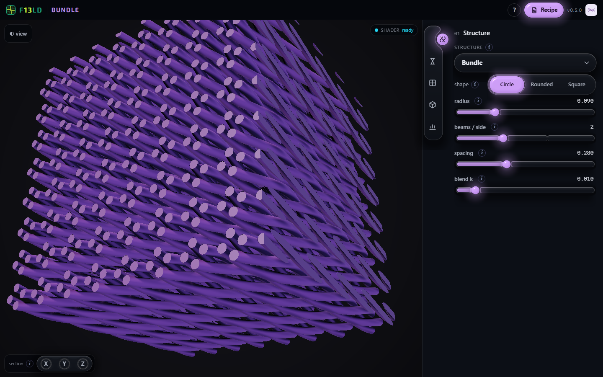

# F13LD.bundle

**Twisted fiber bundles, helicoids, braids, and weaves for the F13LD design suite.**

A browser-native designer for interwoven implicit scaffolds — twisted beam arrays, multi-start helicoids, helical braids, and over/under weaves — with a real-time GPU preview, fabric-tensor homogenisation, and one-click handoff to the mesher. No installation, no server, no build step.

**Live tool:** [mshomper.github.io/f13ld.bundle](https://mshomper.github.io/f13ld.bundle/)

---

## What it does

- Designs four families of interwoven scaffold from a single implicit (SDF) engine
- Renders a real-time, GPU-raymarched 3D preview (WebGL) plus a slice/section viewer
- Reports homogenised elastic anisotropy via an MIL-HS fabric-tensor estimate over the `[-π, π]³` domain
- Exports a full-fidelity JSON recipe consumable by every other F13LD tool
- One-click **Recipe → Mesh** to open the design in F13LD.mesh and export a watertight 3MF
- Loads a recipe back in (file, drop or paste), with Undo
- Runs entirely in the browser — single HTML file, no install, no build

---

## Structures

| Structure | Description |
|---|---|
| **Bundle** | A twisted array of beams — configurable cross-section (circle / rounded / square), count per side, spacing, and column gap — twisted about Z. Optional warp bends the bundle along its axis. |
| **Helicoid** | Multi-start helicoid sheets defined by pitch, thickness, inner/outer radius, and start count. **Alternating** reverses the twist chirality every other period as a smooth spring/perversion (no seam); **Checkerboard** flips handedness per column. |
| **Braid** | N helical strands wound into a rigid braid — strand count, braid radius, fiber radius, and column gap. **Checkerboard** alternates handedness per column. |
| **Weave** | An over/under woven warp + weft — period, strand radius, crossing amplitude, and vertical gap. |

---

## Controls

The controls sit in five sections, one at a time: **Structure**, **Twist**, **Tiling**, **Solid** and **Analyze**. On desktop a rail beside the panel switches them; on a phone the panel is a bottom sheet with a tab bar. Every (i) opens its help card, and the card's **show** button jumps to the control. A control that belongs to another structure says which one instead of switching.

### Structure

- Structure (bundle / helicoid / braid / weave) and its own sliders
- **Handedness** — **Checkerboard** flips handedness on alternating columns (bundle/helicoid/braid); **Alternating** (helicoid only) reverses the twist chirality every other period along Z, a spring-like double-back with no seam

### Twist

- **Twist rate** about Z, and a per-column twist mode
- **Warp** — axis, amplitude, frequency and frame, to bend the structure along its axis. The warp settings are hidden while warp is Off.
- Weave has no twist: the Twist tab is dimmed and opens a note.

### Tiling

- Column and layer gaps
- **Z-ramp (X/Y)** and **checker step** — vertical offsets that, when set to self-tile, repeat seamlessly through the mesher

### Solid

- **Sheet / half-solid / solid** surface mode, and which **side** is solid
- **Iso offset** — shifts the isosurface to thicken or thin the structure
- **Sheet width** — shell thickness in sheet mode

### Analyze

**Run homogenization** estimates the structure's directional stiffness using a Mean-Intercept-Length fabric tensor with Hashin–Shtrikman bounds, computed over the periodic `[-π, π]³` domain. Results belong to the current design and structure: they clear when either changes, and on import.

### Recipe menu

The header's **Recipe** menu holds **Open recipe…**, **Export JSON**, **Queue**, **Choose queue…**, **Mesh** and **Lab**.

---

## Importing a recipe

**Recipe → Open recipe…**, dropping a `.json` file on the page, or pasting recipe JSON loads a bundle recipe back into the tool. The header then says what was imported, with **Undo** to restore the previous design.

- Recipes from another F13LD tool are refused, with that tool's name.
- Older recipes that carry only `family: "bundle"` are accepted.
- Values outside a slider's range are clamped, with a warning. Unknown keys are ignored.
- E_s, ν and the grid come back; homogenization results do not (run it again).

---

## Getting the result into the mesher

Choose **Recipe → Mesh**. The current parameters are serialised to a JSON recipe (`surface.type: "ihb"`, `family: "bundle"`), URL-encoded as a `?r=` query parameter, and opened in [F13LD.mesh](https://mshomper.github.io/f13ld.mesh) pre-loaded — no download or copy-paste. The recipe carries the full parameter set for a faithful rebuild, plus the homogenisation block if results exist for the current design. The resulting URL is bookmarkable and shareable.

In the mesher, the Bundle field is re-scaled to world units, tiled through your domain (or imported shape) via GL_REPEAT, and meshed to a watertight 3MF.

---

## Coordinate system

The SDF is evaluated over a `[-π, π]³` design domain. One structural cell — `nx·d + gap` (bundle), `2·hOuter + hGap` (helicoid), `2·(bRadius + fiber) + bGap` (braid), or `wvP` (weave) in plane — maps to a fixed world span when imported, so the in-plane pitch and the Z-twist period both tile correctly. The `scene()` field is negative-inside with iso / sheet / solid topology folded in, matching the convention shared across the F13LD suite.

---

## Architecture

Single HTML file. No build step, no npm, no server.

- **Real-time preview** is a WebGL 1.0 fragment-shader raymarcher of the implicit field, with a separate CPU section/slice viewer for cross-sections.
- **Rendering (v0.5.0)** — quality is automatic (no Low/Med/High). While anything moves the view renders at an adaptive reduced scale and is upscaled; about 150 ms after it stops, one full-resolution frame is drawn in strips and swapped in. Slider drags never recompile the shader. Nothing draws while the view is idle, and a lost WebGL context is rebuilt without a reload.
- **Controls** use the [liquid-ui](https://github.com/mshomper/liquid-ui) widgets (sliders, dropdowns, segmented controls, toggles, Recipe menu), drawn in WebGL over the native inputs, which stay the source of state. Without WebGL the native controls are shown instead.
- **One implicit engine** drives all four structures; the same `scene()` math is ported verbatim into F13LD.mesh so the preview and the meshed output agree.
- **Homogenisation** runs on the CPU over the periodic domain and surfaces directional moduli alongside the recipe export.

---

## Part of the F13LD Suite

The full tool list, what each one does and how recipes move between them: **[f13ld.app](https://f13ld.app)**.

---

## Credits

Built by [Not a Robot Engineering](https://notarobot-eng.com) as part of the F13LD computational materials design suite.
